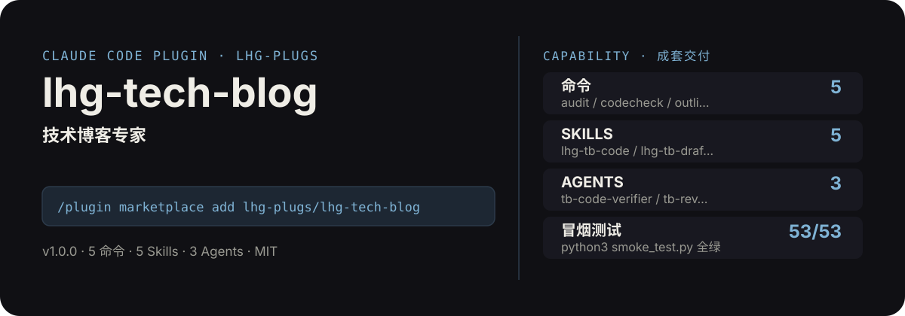

<!-- About 简介（推送后填写到仓库 About 栏）：
技术博客专家：技术主题一句话成文——选题大纲、初稿写作、代码示例自动校验、多平台排版、发布前自查，一条龙。 ｜ 一键安装：/plugin marketplace add lhg-plugs/lhg-tech-blog
-->
<!-- topics（推送后打）：claude-code, claude-plugin, agent-skills, tech-blog, writing, blog, tutorial, code-review -->

<p align="center">
  
</p>

> **一句话介绍**：技术博客专家：技术主题一句话成文——选题大纲、初稿写作、代码示例自动校验、多平台排版、发布前自查，一条龙。

**一键安装**：在 Claude Code 里运行

```bash
/plugin marketplace add lhg-plugs/lhg-tech-blog
/plugin install lhg-tech-blog@lhg-plugs
```

## 它能帮你做出什么

- **冒烟全绿**：`python3 smoke_test.py` 53 项全部通过（JSON 合法、frontmatter 完整、命令/skill/agent 齐全）。

## 它是什么

`lhg-tech-blog` 是一个 Claude Code 插件（plugin 为主、skill 为辅）：

- **5 个命令**（小白入口）：`audit` 技术博客发布前自查、`codecheck` 技术博客示例校验、`outline` 技术博客大纲、`reformat` 技术博客多平台排版、`tech-blog` 技术主题一句话成文
- **5 个平台中立 skill**（方法论，可移植到豆包/Workbuddy 等 agent 平台）：lhg-tb-code, lhg-tb-draft, lhg-tb-format, lhg-tb-outline, lhg-tb-review
- **3 个专家 agent**：tb-code-verifier, tb-reviewer, tb-writer
- **2 个 hooks**（`hooks/`：post_write_hint.py, pre_publish_gate.py），关键操作前自动把关

## 为什么是它

不是一个 prompt，而是一套互相兜底的机制：

1. **硬门，不是提醒**：hooks 在关键操作前自动拦截或警告（见 `hooks/`），而不是只在文档里写一句"请注意"。
2. **方法论沉淀在 skill 里**：流程、检查清单、口径都写在 `skills/` 的方法论里，命令只是入口；换个 agent 平台也能复用同一套做法。
3. **可验，不是可信**：`fixtures/` 备有坏/好对照用例，`smoke_test.py` 一键验证，规则有没有生效、自己跑一遍就知道。

## 快速上手

```bash
# 1. 安装（Claude Code 里运行）
/plugin marketplace add lhg-plugs/lhg-tech-blog
/plugin install lhg-tech-blog@lhg-plugs

# 2. 技术主题一句话成文：选题澄清→大纲→初稿→代码示例生成→可运行性校验→多平台排版
/lhg-tech-blog:tech-blog "Python 重试装饰器"
```

| 命令 | 作用 | 示例 |
|---|---|---|
| `/lhg-tech-blog:audit` | 技术博客发布前自查：跑 40 条确定性审计 + 人工终审清单，blocker 清零才能发。 | `/lhg-tech-blog:audit drafts/` |
| `/lhg-tech-blog:codecheck` | 技术博客示例校验：提取稿件代码块做语法检查，Python 示例真实运行冒烟，输出 blocker 清单。 | `/lhg-tech-blog:codecheck drafts/` |
| `/lhg-tech-blog:outline` | 技术博客大纲：选题澄清→读者定位→五段式大纲（问题/原理/实践/坑/总结），大纲确认后再写正文。 | `/lhg-tech-blog:outline "讲透 Redis 缓存击穿"` |
| `/lhg-tech-blog:reformat` | 技术博客多平台排版：一份初稿输出掘金/知乎/公众号三版（链接、代码块、标题差异适配）。 | `/lhg-tech-blog:reformat draft-retry.md` |
| `/lhg-tech-blog:tech-blog` | 技术主题一句话成文：选题澄清→大纲→初稿→代码示例生成→可运行性校验→多平台排版→发布前自查，一条龙。 | `/lhg-tech-blog:tech-blog "Python 重试装饰器"` |

## 什么时候用 / 什么时候不用（FAQ）

**什么时候用：**

- 你需要技术博客发布前自查时 → 用 `/lhg-tech-blog:audit`
- 你需要技术博客示例校验时 → 用 `/lhg-tech-blog:codecheck`
- 你需要技术博客大纲时 → 用 `/lhg-tech-blog:outline`

**什么时候不用：**

- 你只需要其中一个零散能力时 → 本插件是成套流程，单点需求用更轻量的 skill 更合适
- 你希望 AI 完全自由发挥、不接受任何自查与硬门时 → 它的规则审计与 hooks 会介入（可关，但那就别装它）
- 你的场景不在上面命令表覆盖范围内时 → 先看命令表，没有对应命令就别硬套

## 目录结构

```
lhg-tech-blog/
├── smoke_test.py          # 一键冒烟测试
├── ATTRIBUTION.md         # 灵感来源与许可声明
├── LICENSE                # MIT
├── README.md              # 本文件
├── .claude-plugin/
├── agents/
├── commands/
├── fixtures/
├── hooks/
├── scripts/
├── skills/
```

## 自检与反馈

本插件自带质检：每次使用后可跑 `python3 smoke_test.py` 一键验证（本次实测 53 项全部通过）。

发现 bug 或有改进建议，以 `[QC] <一句话问题>` 为标题提交到 https://github.com/lhg-plugs/lhg-tech-blog/issues，正文写清"复现步骤 → 实际表现 → 期望表现"。

同门插件见 [lhg-plugs](https://github.com/lhg-plugs)，86 个插件的完整矩阵在 [marketplace](https://github.com/lhg-plugs/marketplace) 维护。

## 出品：刘洪光

本插件由真人出镜 IP「刘洪光」（安徽合肥）出品，归属 [lhg-skills](https://github.com/lhg-skills)。

- GitHub 主页：https://github.com/lhg-skills —— 全部 skill 开源在此，欢迎 star
- 抖音：搜「刘老师讲AI实战」
- 微信：lhgsmsw
